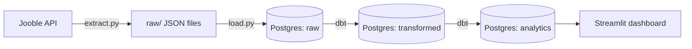

# Nigeria Data Jobs Tracker

An end-to-end data pipeline that collects Nigerian data job listings, cleans them with dbt, and shows what the market looks like on a Streamlit dashboard.

## What it does
1. **Extract:** pulls data job listings from the Jooble API and saves each response untouched.
2. **Load:** copies the raw files into a Postgres database.
3. **Transform:** dbt removes duplicates, fixes blanks and dates, and cleans descriptions.
4. **Summarize:** dbt builds small tables (top skills, top companies, remote vs on-site, job types, jobs per week).
5. **Show:** Streamlit reads the summary tables and draws the dashboard.

## Architecture

## Data layers
| Schema | What it holds |
|---|---|
| `raw` | Job listings exactly as received (never modified) |
| `transformed` | One clean row per job |
| `analytics` | Summary tables used by the dashboard |

## Tech stack
Python, PostgreSQL, Docker, dbt, Streamlit, Git and GitHub

## Data quality
dbt tests check that every job has a unique id, a title and a company.

## Run it locally
1. Clone the repo, create a virtual environment, then run `pip install -r requirements.txt`.
2. Copy `.env.example` to `.env` and fill in your settings (you need a Jooble API key and a running Postgres).
3. Collect and load: `python src/extract.py`, then `python src/load.py`.
4. Build the tables: `dbt run --project-dir dbt --profiles-dir dbt`.
5. Test them: `dbt test --project-dir dbt --profiles-dir dbt`.
6. Open the dashboard: `streamlit run dashboard/app.py`.

## Limitations
- The sample is small, and trends need more days of collection.
- Skill counts come from job titles and short descriptions, so real demand is higher.
- Search results are not limited to Nigeria, so a few foreign or remote jobs appear.
- The Jooble API key has a limited request budget.

## Roadmap
- [ ] Deploy to AWS: S3 for raw files, RDS for the database, Lambda to run the pipeline, EventBridge to schedule it
- [ ] Collect on a schedule so trends build up over time