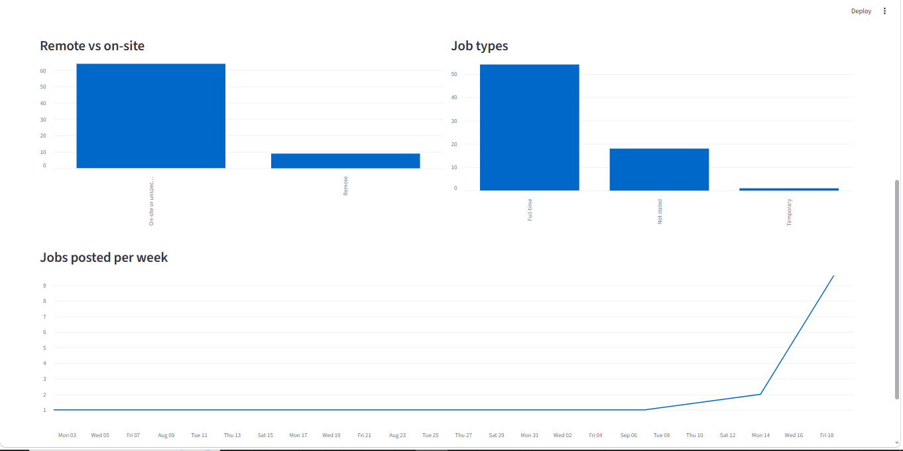
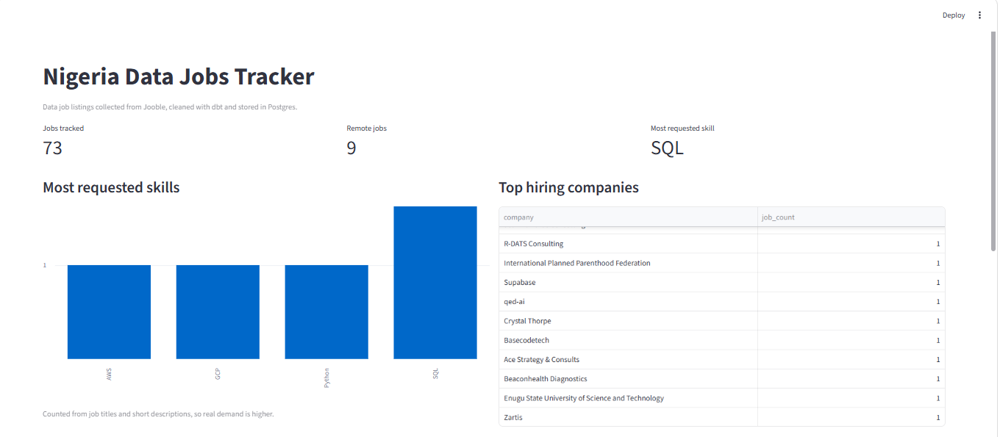
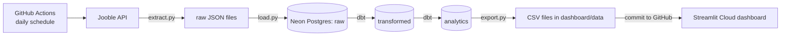

# Nigeria Data Jobs Tracker

An automated data pipeline that collects Nigerian data job listings every day, cleans them with dbt, and shows what the market looks like on a live Streamlit dashboard.

[](https://nigeria-job-market-tracker-c2dqzraz9ouopa9qo4cgnt.streamlit.app)

**Live dashboard:** [https://nigeria-job-market-tracker-c2dqzraz9ouopa9qo4cgnt.streamlit.app](https://nigeria-job-market-tracker-c2dqzraz9ouopa9qo4cgnt.streamlit.app)





## What it does
1. **Extract:** pulls data job listings from the Jooble API and saves each response untouched as JSON.
2. **Load:** copies the raw responses into a hosted Postgres database (Neon).
3. **Transform:** dbt removes duplicates, fixes blanks and dates, and cleans descriptions.
4. **Summarize:** dbt builds small tables (top skills, top companies, remote vs on-site, job types, jobs per week).
5. **Export:** `export.py` writes the summary tables to five CSV files in `dashboard/data`.
6. **Publish:** the workflow commits the new CSVs to GitHub, and Streamlit Cloud redeploys the dashboard with the fresh data.

## How it runs automatically
A GitHub Actions workflow (`.github/workflows/daily.yml`) runs the whole pipeline every day at 05:00 UTC (6:00 AM in Nigeria). It runs on GitHub's servers, so no personal computer needs to be on. It can also be started by hand from the Actions tab with **Run workflow**.

If any step fails (extract, load, dbt run, dbt test or export), the run stops and nothing is published, so the dashboard never shows half-updated data.

## Architecture



## Data layers
| Schema | What it holds |
|---|---|
| `raw` | Job listings exactly as received (never modified) |
| `transformed` | One clean row per job |
| `analytics` | Summary tables exported to CSV for the dashboard |

## Tech stack
Python, PostgreSQL (Neon), Docker, dbt, GitHub Actions, Streamlit, Git and GitHub

## Data quality
dbt tests check that every job has a unique id, a title and a company. The pipeline stops if a test fails.

## Project structure
```
.github/workflows/daily.yml   daily schedule
src/extract.py                pull jobs from Jooble
src/load.py                   load raw JSON into Postgres
src/export.py                 write analytics tables to CSV
dbt/                          transformations and tests
dashboard/app.py              Streamlit app (reads dashboard/data/*.csv)
pipeline.py                   runs extract, load, dbt run and dbt test in order
```

## Settings (secrets)
The pipeline reads its settings from environment variables. In GitHub they are stored as repository secrets, and locally they live in `.env` (never committed).

| Name | Purpose |
|---|---|
| `JOOBLE_API_KEY` | Jooble API access |
| `DB_HOST`, `DB_PORT`, `DB_NAME` | Database address |
| `DB_USER`, `DB_PASSWORD` | Database login |
| `DB_SSLMODE` | `require` for the hosted database; optional locally |

## Run it locally
1. Clone the repo, create a virtual environment, then run `pip install -r requirements.txt`.
2. Copy `.env.example` to `.env` and fill in your settings (you need a Jooble API key and a running Postgres, for example in Docker).
3. Run the pipeline: `python pipeline.py` (extract, load, `dbt run`, `dbt test`).
4. Export the CSVs: `python src/export.py`.
5. Open the dashboard: `streamlit run dashboard/app.py`.

## Limitations
- History builds up one day at a time, starting from the first automated run, so trends need more days of collection.
- Skill counts come from job titles and short descriptions, so real demand is higher.
- Search results are not limited to Nigeria, so a few foreign or remote jobs appear.
- The Jooble API key has a limited request budget.

## Roadmap
- [x] Hosted Postgres so the pipeline runs without a personal computer (Neon)
- [x] Collect on a schedule so trends build up over time (GitHub Actions)
- [x] Deploy the dashboard on Streamlit Cloud, refreshed automatically from the daily data